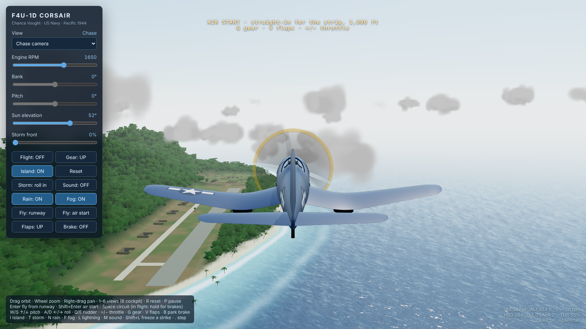

# F4U Corsair

Prototype for a Pacific flying game: an F4U-1D Corsair over a volcanic jungle island with a forward airstrip, in a single three.js page. It started as a model viewer (orbit, blueprint elevations, a cockpit) and now flies: take off from the strip, fly anywhere, land back on it. Weather is the other half: a storm front that rolls in across the island with rain, lightning and thunder, and a cloud deck you can climb through and sit above.

## Flying

**Enter** puts you at the west end of the strip in the three-point attitude with the parking brake set. **Shift+Enter** is an air start, 4.4 km out on the extended centreline at 1,000 ft, clean. **Space** is the original circuit autopilot (cinematic, hands off). **R** resets to the inspection view.

The flight model is a rigid body with a simplified aero model: lift with a stall break and wing drop, induced and parasite drag, gear and flap drag, constant-power thrust (2,000 hp through the prop, capped near static thrust), and the slipstream over the tail. A centred stick holds about 1 g, so you can let go of the keys and the airplane keeps its flight path; the stick adds alpha on top of that, limited to about +6 g. Each tyre is a spring and damper with rolling and side friction, and the tailwheel steers with the rudder at taxi speed.

- **Takeoff.** Throttle past 40% releases the parking brake (it can't hold takeoff power, and the Corsair would nose over on it). The tail lifts by itself around 80 kt; hands off it leaves the ground at about 98 kt clean, 83 kt with flaps, in 10–12 s.
- **Stall.** About 88 kt clean. The overlay warns, then a wing drops.
- **Landing.** The gear takes about 5 m/s (1,000 fpm) of sink; the overlay reports touchdown sink rate. Much harder and the gear collapses.
- **Crashes.** Terrain, a wingtip, the prop, a belly landing or the sea end the flight. Enter, Shift+Enter or R restarts.
- **No limits.** No fuel, no boundary: the sea, sky and fair-weather clouds travel with you. The readout gives range and bearing back to the strip.

## Weather

The storm slider (or **T**) rolls a front in from the west-southwest. Rain, darkness, gusts and lightning all follow where you are relative to the front, not a global switch: fly out from under it and it clears.

The deck is a real layer: base about 2,300 ft, tops about 7,900 ft. Inside it the world goes grey at about 200 m visibility. Above the tops the rain, turbulence and storm lighting fall away, the deck lies sunlit below, and lightning lights it from underneath.

The fog and horizon haze are matched to the sky: the sky's horizon colour is sampled whenever the sun moves and tone-mapped the same way the sky is, so the sea melts into it by day and the horizon goes dark after sunset.

## Sound

Off until you press **M** (browsers need a gesture first). Everything is synthesised with Web Audio, no sample files: the R-2800's nine firing pulses per crank revolution with crank lope and combustion flutter, exhaust roar with power, the prop's blade-pass beat, airflow that builds with airspeed, exhaust crackle when you chop the throttle at high rpm, and the rain, wind and thunder of the storm. Inside the cockpit it's muffled and heavier.

## Controls

| Input | Action |
|---|---|
| Enter / Shift+Enter | Fly from the runway / air start |
| W S or ↑ ↓ | Pitch (S / ↓ pulls) |
| A D or ← → | Roll |
| Q E | Rudder (and tailwheel steering) |
| = − (or PageUp / PageDown) | Throttle |
| G | Gear (stays down with weight on the wheels) |
| V | Flaps |
| B | Parking brake; hold Space for wheel brakes in flight mode |
| 1–6 | Views: orbit, chase, blueprint plan/front/side, cockpit |
| Mouse | Orbit and zoom; in the cockpit, drag to look and wheel to zoom |
| T / N / F / L | Storm, rain, fog, lightning strike |
| M | Sound |
| P / . | Pause / step a frame (photo mode; cameras stay live) |
| R | Reset |

A gamepad works too: left stick flies, and on pads with the standard mapping the right stick is rudder, the triggers are throttle and A is brakes. Flight sticks with their own throttle lever report rudder and throttle on different axes per device, so use the keys for those.

## Notes

- Target is a Chromebook-class laptop. Below about 20 fps the sim runs slower than real time (frame time is capped at 50 ms).
- Trees, buildings and the parked aircraft don't collide; terrain, the strip and the sea do.
- Loads three.js 0.161 from jsDelivr.
