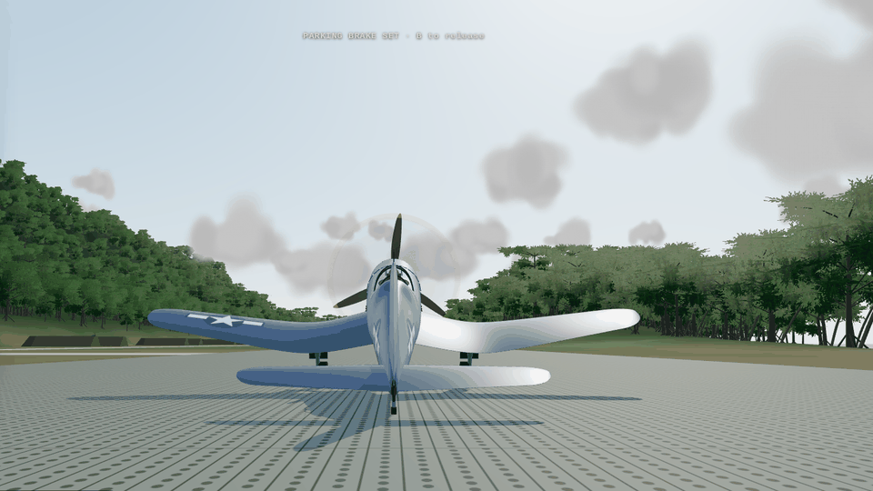
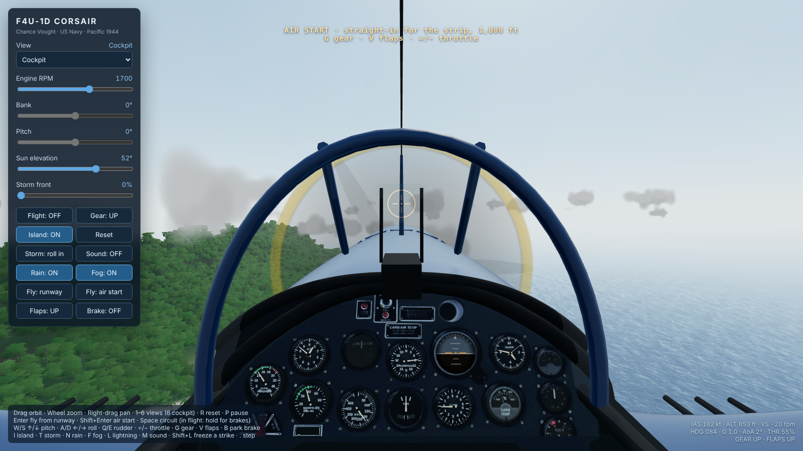
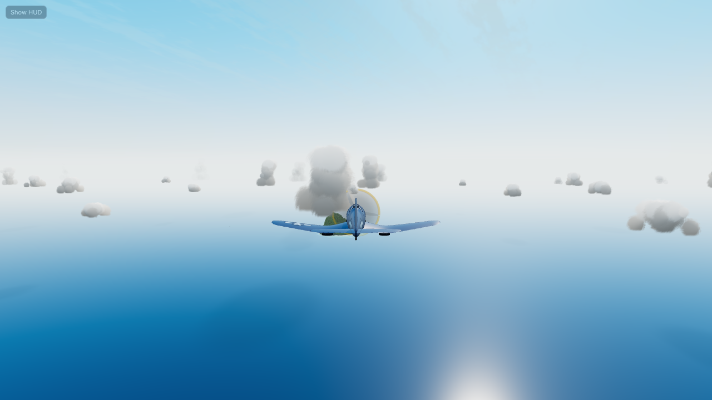
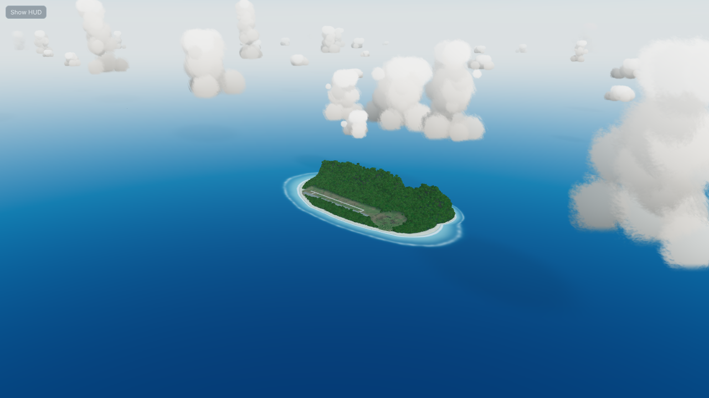
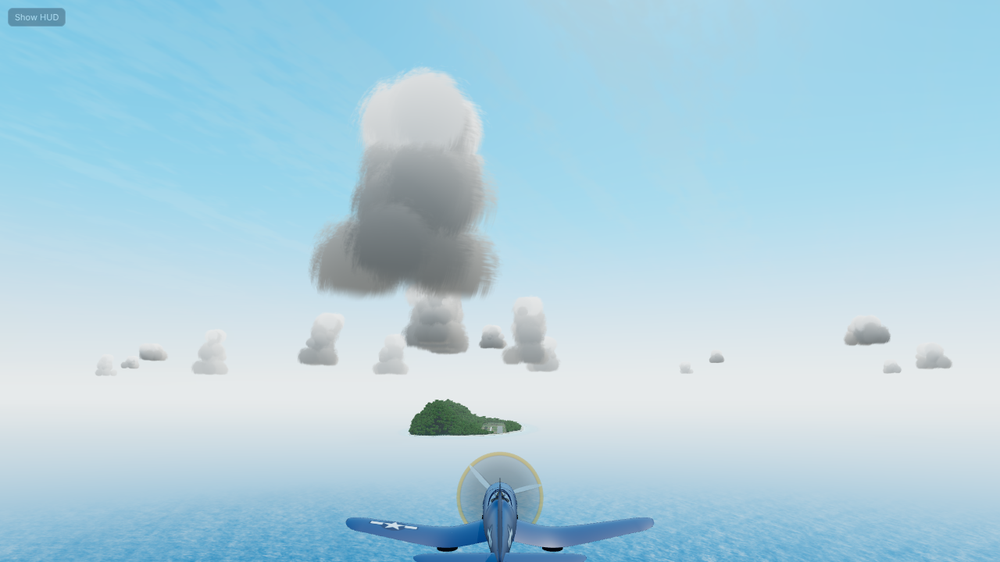
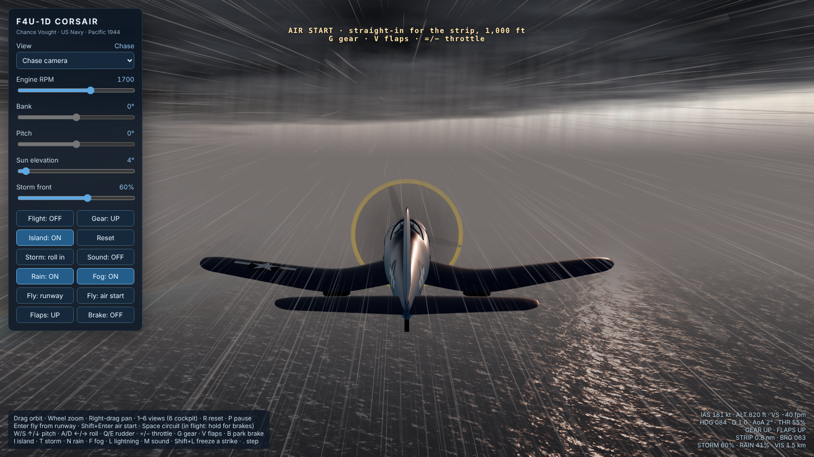
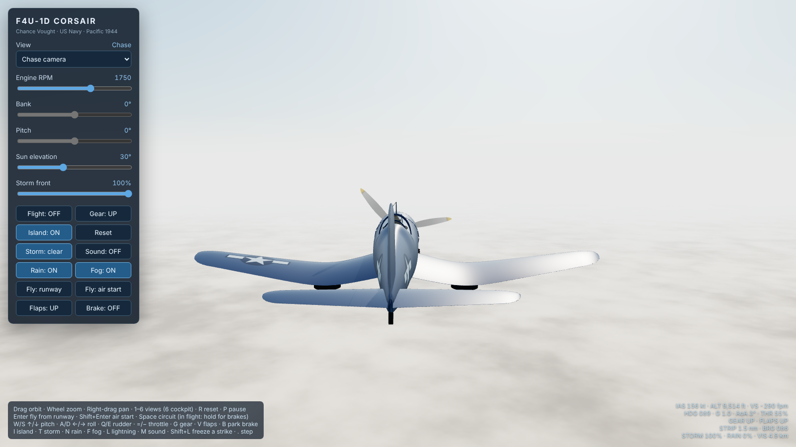

# F4U Corsair

Prototype for a Pacific flying game: an F4U-1D Corsair over a volcanic jungle island with a forward airstrip, in a single three.js page. It started as a model viewer (orbit, blueprint elevations, a cockpit) and now flies: take off from the strip, fly anywhere, land back on it. Weather is the other half: a storm front that rolls in across the island with rain, lightning and thunder, and a cloud deck you can climb through and sit above.

## A6M2 Zero

The second airframe, for the dogfight to come: an A6M2 Model 21 in natural metal, built on the same loft and airfoil helpers as the Corsair. It has a black NACA cowling over a 14-cylinder two-row Sakae, a 2.9 m Sumitomo three-blade prop with a long silver spinner, a one-piece low wing (6.5° dihedral, straight leading edge, rounded tips) with the 20 mm cannon barrels and the port pitot, the long framed greenhouse canopy, and the radio mast with its wire to the fin. The mains retract inward into the centre section and the tailwheel folds aft. Markings are red hinomaru on the fuselage and on the upper and lower surfaces of both wings, a red band round the rear fuselage, and EII-142 on the fin.

Pick it from the Aircraft selector, or press **Z**. It works in orbit, chase, the circuit autopilot and all three blueprint elevations. The manual flight model and the cockpit are still the Corsair's: Enter or Shift+Enter switch back to the Corsair, and the Zero has no cockpit view yet.

## Dogfight

**K** (or the Dogfight button) puts you in a Corsair at 4,000 ft, 6.5 km west of the strip, at 250 kt. A wingman flies combat spread 220 m off your right. A Zero is crossing ahead 2,000 ft below you and hasn't seen you. Hold **X** to fire (on a gamepad, RB or B). You have 30 s of ammunition, about what six .50s with 400 rounds each give you. Kills reset with each new fight.

The Zero and the wingman are separate copies of the two airframes, flown by AI on a point-mass energy model. Lift is limited by stall and structure (6.5 g for the Zero, 7 for the Corsair), with induced and parasite drag and constant-power thrust. Roll rate falls off with speed, sharply for the Zero above about 300 kt, as the real airplane's did. Roll has inertia: the roll rate builds up at a limited roll acceleration, and the commanded bank is smoothed, so the AI doesn't flick back and forth in hard turns. Both fly lead pursuit with the line-of-sight rate fed forward, aim with the nose rather than the flight path, steer out of collision courses, and keep a pull-out margin above the sea and the island that grows with speed and sink rate.

**The Zero** cruises unaware until you come within 1.5 km, hit it, or 25 s pass. Then it attacks whichever of you is closest and ahead of it. It breaks hard toward an attacker that's behind it and pointing at it. It fires two 7.7 mm guns, and two 20 mm cannon until the cannon ammunition (about 7 s) runs out. Replacement Zeros arrive 6 s after a splash, either low and unaware or inbound and alert.

**The float carburettor.** Push over hard (W) with a Zero on your tail. Most Zero pilots (three in four here) follow with a pushover instead of a half-roll, and sustained negative g starves the engine: it cuts out for about two seconds, with a puff of black smoke and a call. They push for about a second at most before rolling instead. This is the finding from the Akutan Zero, captured in 1942 and test-flown by the US Navy. The Corsair has no such problem.

**The wingman** holds combat spread until the Zero comes near either of you, then engages it. When the Zero is on your tail he calls the break ("ZERO ON YOUR TAIL! BREAK RIGHT · drag him across my nose"). He turns in toward you, and the Zero following you gets dragged across his nose. That's the Thach Weave idea, and he takes snap shots at close range as his nose sweeps through. If the Zero turns on him, he breaks toward you. There is no friendly fire.

What the tests showed (scripted, stepped without rendering):

- **Turn with a Zero on your tail, alone:** about 45% damage in 18 s.
- **Push over and dive away:** its engine cuts about 3 s in, and you're 3 km clear in 20 s with about 3% damage.
- **Keep turning toward your wingman:** 2–8% damage, and in one run he shot it down 16 s in.
- **Hands-off opening:** the wingman engages the Zero and kills it.

Cues: a red box marks the bandit with its range, and a blue ring marks the wingman. Off screen, arrows on the edge point to each. The cross is your gun line at 300 m convergence; the ring is the lead point, and putting the cross on it hits. The readout gives bandit and wingman range, clock position and high/low, plus UNAWARE, ENGINE OUT, your guns, your damage and kills (the wingman's counted separately).

Damage: smoke is laid as a trail, with puffs at fixed spacing along the path flown since the last frame, so it stays continuous at any speed or frame rate. Puffs right at the camera fade out. Hits on the Zero flash the box. A hurt aircraft trails grey smoke; a dead one burns, trails black smoke and rolls away. When you're hit, the screen edge flashes red. Heavy damage caps your power and you trail smoke. Shot down, the engine quits and the controls are gone until you hit the water. Rounds that miss splash on the sea or kick up dust on land. Gunfire sound isn't in yet; it's a job for the sound lab.

## Watching, cameras and capture

Ported from Six Fleets' arcade skirmish, so the keys match across the games.

- **Watch** (Shift+K, the Watch button, or `?watch` in the URL) starts a dogfight with your Corsair flown by an AI captain: computer against computer. **J** turns the autopilot on and off at any time, in watch mode or in a fight you started yourself, so you can hand the airplane over or take it back mid-fight. Taking over starts from the captain's exact state, with no jolt. The captain is the wingman's brain flying as a flight lead. It bounces the Zero, breaks toward the wingman when the Zero is on its tail, and keeps Corsair discipline: below about 170 kt, and not about to shoot, it breaks off and dives away to rebuild speed before coming back. The wingman does the same.
- **Cameras.** V or Tab cycles the style:
  - **Chase:** behind the aircraft.
  - **Target:** behind it on the line from what it's fighting, looking past it at the enemy.
  - **Fly-by:** parked where the aircraft will be in about 1.6 s, counting its current turn, off to one side of its flight path. It flies past and the camera re-parks once it's clear, or as soon as it turns away.

  Shift+V cycles who the camera follows: you, the wingman or the Zero. Orbit view (1) follows the same aircraft, starting close in, and shadows follow whatever the camera follows. Cockpit and blueprint views are yours only. The gun cross and lead ring show only when you're looking from your own airplane.
- **Photo** (P) saves a PNG of the 3D view, without the HUD. It's grabbed right after a frame is drawn, before the browser clears the WebGL buffer. Pause with Esc, frame the shot with the orbit or fly-by camera, then press P.
- **Record** (R) saves an MP4 or WebM of the canvas using MediaRecorder. If an encoder writes an empty file, that format is skipped from then on.
- **Clean view** (C) hides the panels and HUD. A faint Show HUD button in the corner brings them back.

## Flying

**Enter** puts you at the west end of the strip in the three-point attitude with the parking brake set. **Shift+Enter** is an air start, 4.4 km out on the extended centreline at 1,000 ft, clean. **Space** is the original circuit autopilot (cinematic, hands off). **R** resets to the inspection view.

The flight model is a rigid body with a simplified aero model: lift with a stall break and wing drop, induced and parasite drag, gear and flap drag, constant-power thrust (2,000 hp through the prop, capped near static thrust), and the slipstream over the tail. A centred stick holds about 1 g, so you can let go of the keys and the airplane keeps its flight path; the stick adds alpha on top of that, limited to about +6 g. Each tyre is a spring and damper with rolling and side friction, and the tailwheel steers with the rudder at taxi speed.

- **Takeoff.** Throttle past 40% releases the parking brake (it can't hold takeoff power, and the Corsair would nose over on it). The tail lifts by itself around 80 kt; hands off it leaves the ground at about 98 kt clean, 83 kt with flaps, in 10–12 s.
- **Stall.** About 88 kt clean. The overlay warns, then a wing drops.
- **Landing.** The gear takes about 5 m/s (1,000 fpm) of sink; the overlay reports touchdown sink rate. Much harder and the gear collapses.
- **Crashes.** Terrain, a wingtip, the prop, a belly landing or the sea end the flight. Enter, Shift+Enter or R restarts.
- **No limits.** No fuel, no boundary: the sea, sky and fair-weather clouds travel with you. The readout gives range and bearing back to the strip.

## Weather

The storm slider (or **T**) rolls a front in from the west-southwest. Rain, darkness, gusts and lightning all follow where you are relative to the front, not a global switch: fly out from under it and it clears.

The deck is a real layer: base about 2,300 ft, tops about 7,900 ft. Inside it the world goes grey at about 200 m visibility. Above the tops the rain, turbulence and storm lighting fall away, the deck lies sunlit below, and lightning lights it from underneath.

The fog and horizon haze are matched to the sky: the sky's horizon colour is sampled whenever the sun moves and tone-mapped the same way the sky is, so the sea melts into it by day and the horizon goes dark after sunset.

## Sky and clouds

The sky, the fair-weather clouds and the haze come from [`lib/longwind-world`](../../lib/longwind-world/), a small library of sky and atmosphere pieces taken from [长风 Long Wind](https://github.com/jbang2004/long-wind) (MIT) and adapted for flying.

- **Cumulus at real scale.** Trade-wind cumulus with flat bases at about 2,000 ft. They're 300 m to 1.3 km across: mostly small and medium, with the odd towering congestus up to about 5,000 ft, and a few building over the island's ridge. Each cloud is a cluster of lit sphere impostors with:
  - sunlight that self-shadows through the cloud
  - grey bases and bright cauliflower tops
  - a silver lining when you look toward the sun
  - edges broken up by Long Wind's baked cloud noise

  The field tiles around you forever. The dogfight at 4,000 ft now happens among the towers.
- **Flying into a cloud.** Inside a cumulus the world goes white. Puffs near the camera fade out and fog takes over, the same way the storm deck does.
- **Cloud shadows.** Each cloud casts its shadow down-sun onto the sea, the island and the aircraft. Shadows weaken as the sun gets low and are gone under the storm deck.
- **Haze that thins with height.** The fog is exponential with altitude (scale height 1,100 m), not uniform. From 4,000 ft the sea below is deep blue instead of milky, and the horizon band thins as you climb. In-cloud and in-deck whiteout stay at full strength at any height.
- **A tropical sky.** The open sky is pre-saturated (Long Wind's trick for keeping blues through the tone mapping), the zenith is deeper, and turbidity is lower. Faint high cirrus drifts with the wind.
- **The deck tops** are lit billows that catch the sun, instead of a flat sheet, and fade into the haze at a distance.

Quality is picked from the GPU (Intel UHD 6xx gets `low`, Iris and newer Intel `med`, discrete GPUs `high`). Force it with `?q=low`, `?q=med` or `?q=high`. The tiers set the number of clouds and puffs: about 2,600 / 4,300 / 6,700 puffs.

## Sound

Off until you press **M** (browsers need a gesture first). Everything is synthesised with Web Audio, no sample files: the R-2800's nine firing pulses per crank revolution with crank lope and combustion flutter, exhaust roar with power, the prop's blade-pass beat, airflow that builds with airspeed, exhaust crackle when you chop the throttle at high rpm, and the rain, wind and thunder of the storm. Inside the cockpit it's muffled and heavier.

## Controls

| Input | Action |
|---|---|
| Enter / Shift+Enter | Fly from the runway / air start |
| W S or ↑ ↓ | Pitch (S / ↓ pulls) |
| A D or ← → | Roll |
| Q E | Rudder (and tailwheel steering) |
| = − (or PageUp / PageDown) | Throttle |
| G | Gear (stays down with weight on the wheels) |
| F | Flaps |
| B | Parking brake; hold Space for wheel brakes in flight mode |
| 1–6 | Views: orbit, chase, blueprint plan/front/side, cockpit |
| V / Tab | Camera style: chase, target, fly-by |
| Shift+V | Follow: you, wingman, Zero (in a dogfight) |
| Mouse | Orbit and zoom; in the cockpit, drag to look and wheel to zoom |
| K / Shift+K | Dogfight: Corsair vs Zero / watch it, computer against computer |
| J | Autopilot on / off (take the stick back any time) |
| X (gamepad RB / B) | Guns |
| Z | Corsair / Zero |
| T / N / Shift+F / L | Storm, rain, fog, lightning strike |
| M | Sound |
| Esc / . | Pause / step a frame (cameras stay live) |
| P | Photo (PNG of the 3D view, no HUD) |
| R | Record video (again to stop and save) |
| C | Clean view: hide the HUD and panels |
| Shift+R | Reset |

A gamepad works too: left stick flies, and on pads with the standard mapping the right stick is rudder, the triggers are throttle and A is brakes. Flight sticks with their own throttle lever report rudder and throttle on different axes per device, so use the keys for those.

## Notes

- Target is a Chromebook-class laptop. Below about 20 fps the sim runs slower than real time (frame time is capped at 50 ms).
- Trees, buildings and the parked aircraft don't collide; terrain, the strip and the sea do.
- Loads three.js 0.161 from jsDelivr, and the sky and cloud modules from `lib/longwind-world/` (same site, through the import map).
