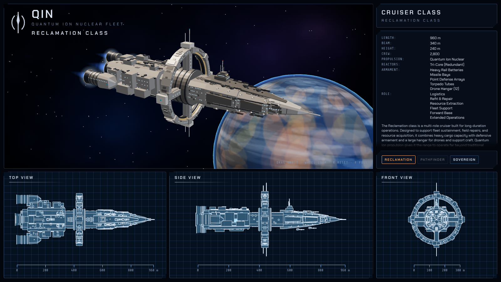
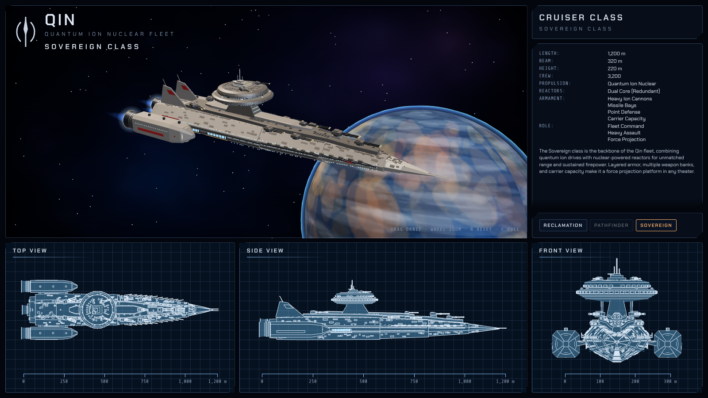
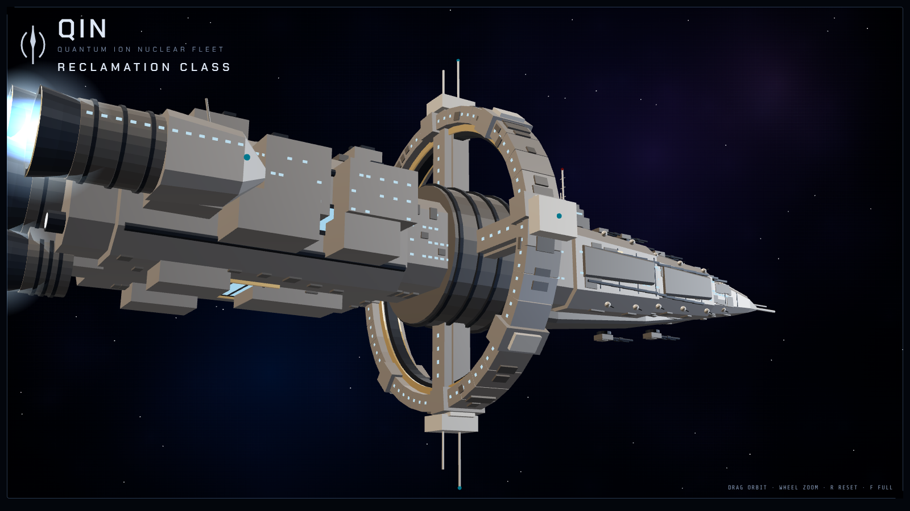

# Shipyard

3D models of the Qin fleet, each shown as a live version of its concept sheet: a hero view you can orbit, the spec panel, and TOP / SIDE / FRONT blueprints drawn from the same model with scale bars.



## Ships

| Ship | Model | Built by |
|---|---|---|
| Qin Reclamation-class cruiser | `assets/qin-reclamation.glb` (52 part meshes, ~27k triangles, 620 KB) | `assets/build_reclamation.py` |
| Qin Sovereign-class cruiser | `assets/qin-sovereign.glb` (50 part meshes, ~36k triangles, 810 KB) | `assets/build_sovereign.py` |
| Pathfinder class | in drydock | |

Open a hull directly with `?ship=reclamation` or `?ship=sovereign`.



## Building a model

```
pip install trimesh numpy --break-system-packages
python3 build_reclamation.py
python3 build_sovereign.py
```

Run each script from `assets/`; they import the shared parts kit in `assets/shipkit.py` (boxes, cylinders, octagon lofts, custom-section lofts, lathes, fins, glow discs, and the merged GLB export). The scripts follow `lab/tauri-reach/assets/build_shrike.py`: boxes, cylinders, lofts and lathes with sRGB vertex colours, exported as GLB. Frame: 1 unit = 100 m, nose -Z, up +Y. Parts are merged by name, so each part type is one mesh and one draw call. The page picks materials by name prefix:

| Name prefix | Material |
|---|---|
| `engine_glow`, `engine_glow_core`, `aux_glow` | unlit HDR drive glow; the page adds halos and plumes from the ship's `glows` list |
| `window`, `hangar_glow` | unlit, vertex colour (blue decks, a few amber) |
| `nav_light` | unlit, double-flash blink |
| `*stripe`, `*lip`, `ring_trim`, `torpedo_ring`, `hangar_frame` | bright metal trim (`accent` colour gives the red Qin markings) |
| everything else | flat-shaded armour, vertex colour |

Lathes that close on the axis (profile starts and ends at radius 0) are wound outward by signed volume, whichever way the profile runs; open y-axis lathes (dishes, skirts) are built two-sided. A solid wound inward renders inside-out (the far wall shows through and reads as glass), so check new parts from above as well as from the side.

## Adding a ship

1. Write `assets/build_<name>.py` on `shipkit.Kit` and run it.
2. Add an entry to `SHIPS` in `index.html`: the model path, spec rows, blurb, `glows` (x, y, z, radius of each drive disc) and the scale-bar ticks. The hero camera and the blueprint views frame themselves from the model's bounds.

## Controls

Drag to orbit, wheel to zoom, R resets the camera, F toggles a full-screen hero view.

`window.__qa` exposes `show(id)`, `pose(x, y, z, yaw)`, `full(on)` and `ready()` for headless captures, plus `scene` and `lights` (`key`, `fill`, `rim`) for lighting checks.


