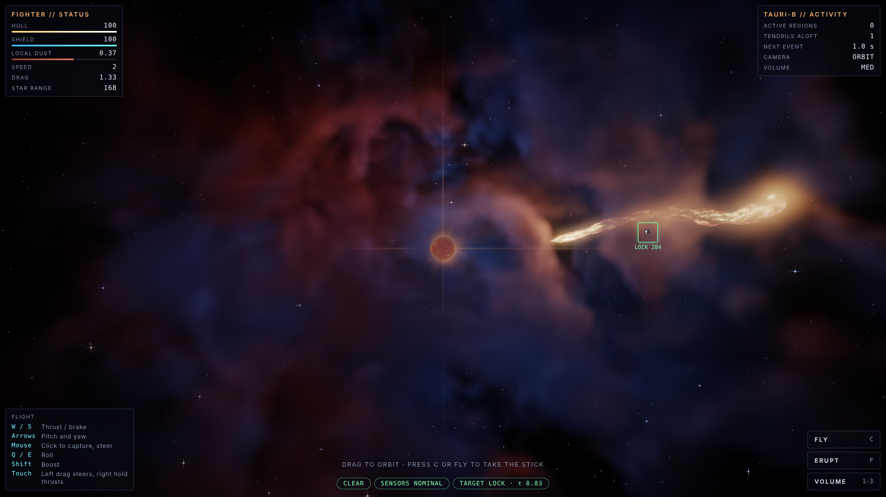
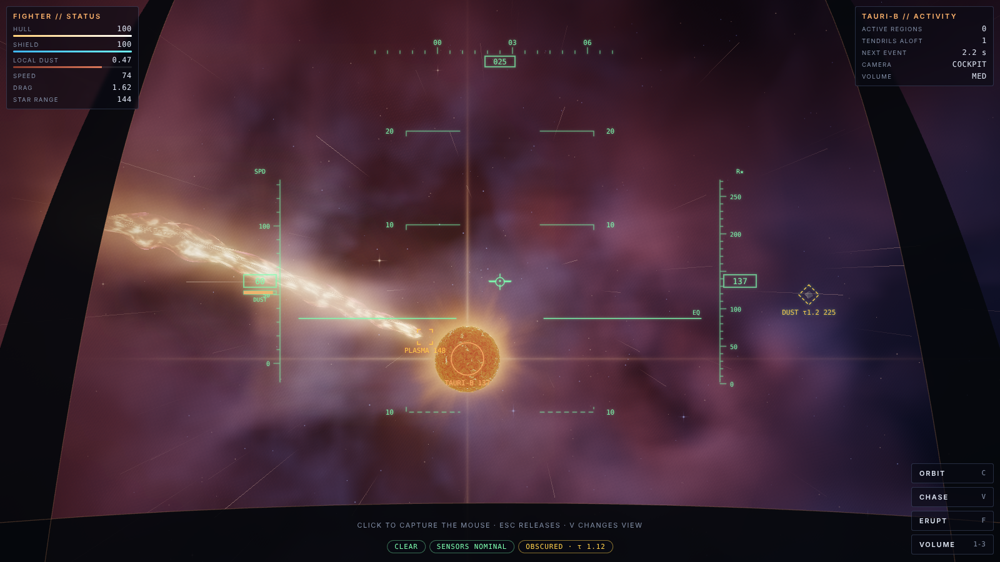
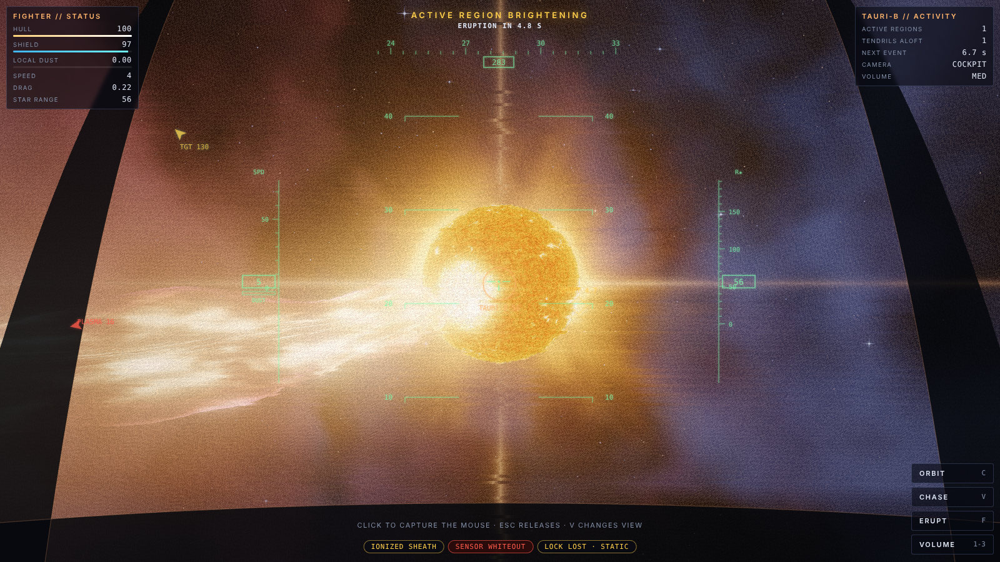
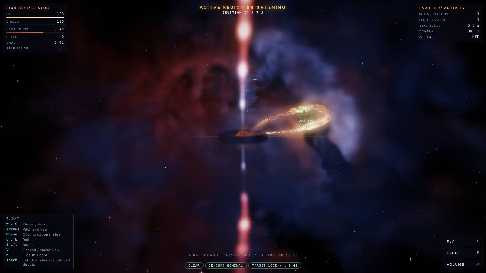
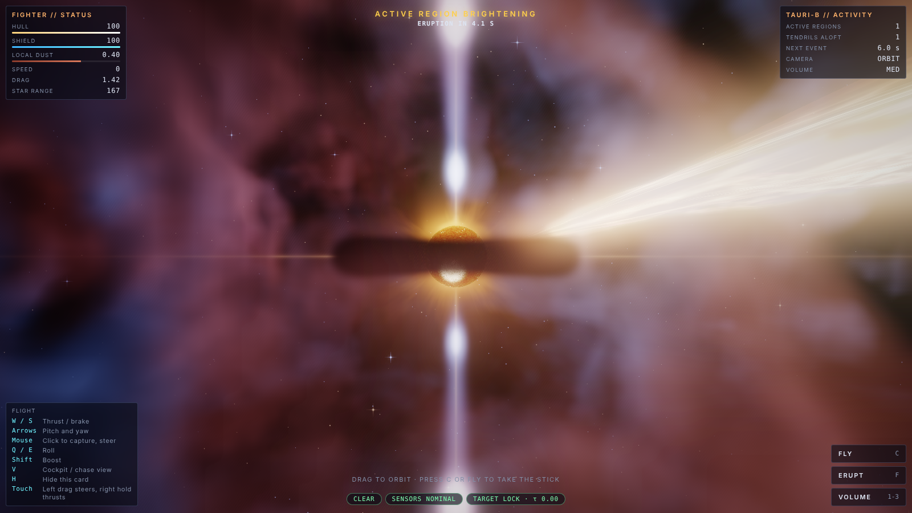
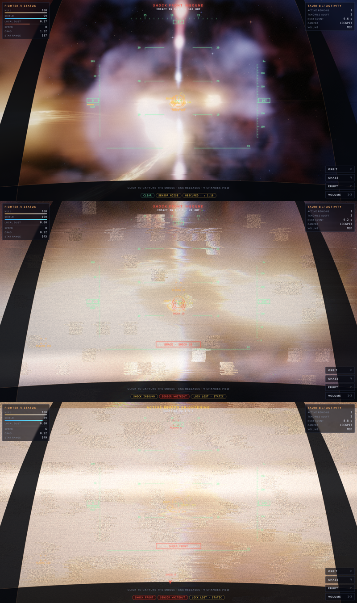
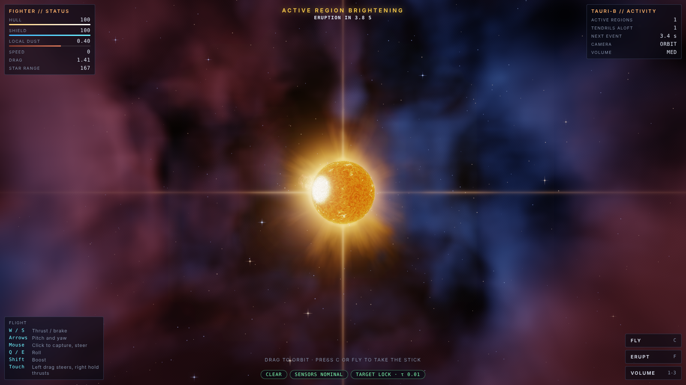

# Tauri Reach

Environment prototype for a space fighter game set inside a nebula around a young, violently active star. There is no combat yet. This is the world the fight will happen in: a volumetric nebula you can fly through, and a star that periodically throws plasma tendrils through it.

## Controls

| Input | Action |
|---|---|
| C or Tab | Switch between orbit camera and flying the fighter |
| V | Cockpit or chase view while flying (cockpit is the default) |
| H | Hide the controls card |
| F | Trigger an eruption now |
| 1 / 2 / 3 | Volume quality: low, medium, high |
| W / S | Thrust / brake |
| Arrows | Pitch and yaw |
| Mouse | Click to capture, then steer |
| Q / E | Roll |
| Shift | Boost |
| Touch | Orbit: drag and pinch. Fly: left half drag steers, right half hold thrusts |

## Cockpit view

The cockpit HUD is drawn on a 2D canvas over the WebGL view:

- **Pitch ladder.** Space has no horizon, so the ladder is referenced to the star's equatorial plane. It rolls with the airframe.
- **Heading tape.** Bearing around the star's spin axis.
- **Side tapes.** Speed on the left, with a dust-density bar. Range to the star on the right.
- **Markers.**
  - A flight-path marker shows where the ship is actually going, not where the nose points.
  - The star and the target drone are marked on screen, and get edge arrows when off-screen.
  - Plasma threats are marked at the closest point on each live tendril.
  - Eruption warnings sit on the active region.
- **Target diamond.** Solid with a lock ring when the line of sight is clear. Dashed with the optical depth when dust blocks it, or `STATIC` when the sheath whites out the sensors.

Static from the ionized sheath jitters the symbology and makes it drop out, but the canopy frame stays still. Plasma contact and hits shake the eye point.

Near-field dust streaks sell speed and density from inside the volume. 700 motes wrap in a box around the camera, each drawn as a line stretched along velocity, with brightness set by local dust density. They warm in color inside a plasma sheath.

## How it works

### One environment, read by both the renderer and the game

At startup the page bakes a 96³ density grid from warped fbm noise (about 0.6 s, sliced across frames so the page stays responsive). The grid is kept twice:

- a `Float32Array` on the CPU, which gameplay reads, and
- the same values uploaded as an RG8 `Data3DTexture`, which the volume shader raymarches. R is dust density, G is tint (red emission gas versus blue reflection dust).

Because both sides read the same field, what you see is what you get:

- **Drag.** The fighter's drag is the dust density at its position.
- **Line of sight.** The target lock integrates optical depth along the line to the drone through the grid, using the same absorption constant as the shader. Dust you can see between you and the target breaks the lock.

### The volume

The nebula is not geometry. A full-screen pass at half resolution casts a ray per pixel, clips it to the nebula sphere and to the opaque scene's depth buffer, and steps along it, accumulating emission and absorption. Each step samples:

- **the density texture,** plus a small tileable detail texture for fine structure. The detail is cosmetic and gameplay ignores it.
- **one extra density sample toward the star,** a cheap self-shadow. Dust faces lit by the star get bright rims; dust behind other dust stays dark.
- **the tendril field,** described below.

A composite pass combines the result with the scene: `scene * transmittance + emission`. Bloom and ACES tone mapping follow.

### The star: eruptions, jets and a disk

The star's activity is modelled on what real young (T Tauri) stars do.

#### Coronal mass ejections

Each eruption runs through four phases:

1. **Warn (3.6 s).** An active region on the surface brightens and flickers. This is the telegraph. In fly mode, the HUD tells you if you are inside the cone the eruption will sweep.
2. **Rise (2.8 s).** A magnetic loop lifts off between two footpoints and arches outward.
3. **Erupt.** The loop becomes a flux rope and inflates while its legs stay anchored to the footpoints, giving the classic "lightbulb" CME shape. Between 1.6 and 3 s its legs reconnect and the rope detaches into a closed ring that keeps expanding outward. Ahead of it runs the **shock front**: a spherical cap centred on the eruption site that lights the dust as it sweeps through.
4. **Fade.** The rope and front dim as the ejection leaves the nebula.

#### Bipolar jets and the accretion disk

- **Jets.** Two collimated jets run along the spin axis. Knots (Herbig-Haro knots) travel up them at 38 u/s, and each jet ends in a bow shock where it rams the cloud. The jets are thinner than a raymarch step, so the shader integrates each one analytically: the gaussian cross-section is evaluated at the ray's closest approach to the axis. The bake carves outflow cavities into the density grid along the axis, with dense walls.
- **Accretion disk.** A flared disk, with its inner rim at 12 units, sits in the equatorial plane. It is sub-sampled where rays cross it. Seen edge-on it reads as a dark lane across the star, which is the look of HH 30.

#### Shared data, hazards and interference

Each eruption's rope is 9 control points, recomputed on the CPU every frame. Its front is a centre, radius and cone. Those same values drive the tube, the volume shader and the hazard checks:

- **Plasma contact** with the rope damages the hull directly.
- **The ionized sheath** around the rope drains shields.
- **A shock front** shoves the ship outward and drains shields as it passes.
- **The jet core** is lethal and throws you along the axis. The jet flanks cause interference.

Interference escalates with how close the shock front is (e-folding every 45 units), not just on contact:

1. **Snow and tearing** come first.
2. **Rolling sync bars, scanlines, color fringing and block dropouts** follow as the front closes.
3. **Frame jumps and white-out frames** hit at impact.

The HUD shows a shock marker with an impact countdown and `BRACE` inside 60 units. Its symbology jitters and drops out with the static, while the canopy holds still.

## Performance knobs

| Quality | Volume resolution | Steps per ray |
|---|---|---|
| Low (touch default) | 1/3 | 36 |
| Medium | 1/2 | 56 |
| High | 1/2 | 96 |

Ray start is dithered per pixel, which turns step banding into fine grain.

Requires WebGL2, because of the 3D textures.
